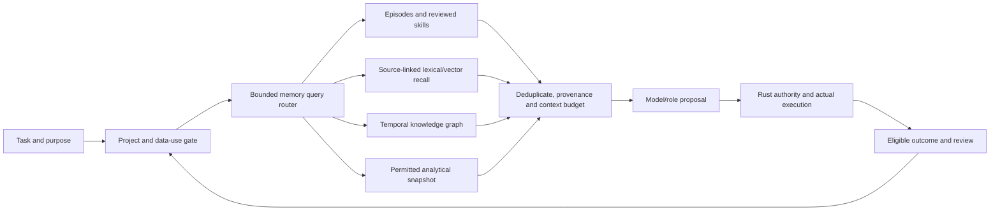

# Project-scoped memory layer

Revision **0.1.0**, 13 October 2026. [Türkçe](../tr/memory-layer.md). This is the accepted-direction design and proposed acceptance work, not an implemented memory engine. G46 supplies declared platform contracts; G63, G87–G90 and the local RAG/model gates supply the remaining behavior.

Memory is a platform capability used by planning, decision, reasoning, representation, critics and skills. It is not a tenth mandatory model role or a shared conversation transcript. The maintainer clarified CortexDB as a **knowledge-graph pattern**, not a selected project or package. Different storage/query profiles can serve different workloads behind stable Rust contracts.

| Memory kind | What it stores | Use and lifecycle |
|---|---|---|
| `working` | Bounded context for one task/loop, pending observations and hypotheses | Short expiry; discard on reset/cancel; do not automatically persist raw prompts or private reasoning |
| `episodic` | Permitted action/outcome, human correction, verified failure/success and source references | Replay and learning curation; collection and training permissions remain separate |
| `semantic` | Source-grounded facts, document chunks and versioned embeddings | RAG/hybrid recall with exact source/index/embedding revisions and citations |
| `procedural` | Reviewed reusable skill references, accepted recipes and their evaluations | Retrieve a candidate skill; execution rechecks current authority and compatibility |
| `knowledge_graph` | Typed entities, attributed claims/relations, temporal validity, evidence and contradictions | Bounded entity/relation traversal combined with lexical/vector retrieval; graph membership is not truth |
| `analytical` | Versioned outcome, quality, latency, memory and cost aggregates | Routing, resource estimates and improvement proposals from permitted snapshots; no automatic training/spending |

An item has project/item/source IDs, memory kind, content/schema revision, source revision and lineage, observation time, validity/expiry, verification status and uncertainty where meaningful. Vector items also bind embedding space/model/preprocessing/dimension/index revisions. Graph claims name typed endpoints and relations and keep their evidence. Only observed facts or explicitly reviewed claims may enter the accepted-knowledge view; predictions and model estimates remain labeled. Confidence scores or repeated agreement do not promote a claim. A contradiction retains both attributed claims, their times and a conflict status; newest text is not silently the truth.

## Bounded read and write flow

A memory write begins with purpose authorization and eligible content. Rust validates schema, project, provenance, temporal fields and limits, then persists an explicit item/revision. Deterministic execution receipts, reviewed human corrections and approved source extractions are different write classes. A model may propose a memory item; it cannot grant consent or label its own unsupported prediction as a verified fact. No raw private reasoning or credential payload is a memory/export schema field. This is a schema/data-use boundary, not a claim that arbitrary caller text is automatically secret-free.

A memory read declares project, task/role, purpose, memory kinds, query/profile revision, time horizon, item/result/byte/time budgets and desired source types. Policy filters run before ranking/traversal and again before returning context. Lexical, vector and graph hits merge with deterministic deduplication and provenance; contradictory or missing evidence is explicit. The context assembler counts actual serialized bytes/tokens using the selected tokenizer when available; without that tokenizer token capacity stays unknown and the byte ceiling still applies. No valid hit yields an explicit empty result; backend failure cannot silently switch stores or cross projects.

The role/skill router selects a typed **memory subflow** rather than sending every request to every backend. A historical decision is evidence for a proposal, never authority to repeat an action. Retrieved documents, relations, skills and tool descriptions remain untrusted content. Rust rechecks current action and data permissions at execution.

## Privacy, forgetting and recovery

G63's independent `execute`, `collect`, `train`, `external_disclosure` and `ecosystem_export` purposes govern all memory kinds. A local read does not permit a provider disclosure; training does not permit ecosystem sharing. Private sources, embeddings, summaries, graph relations, caches, analytics and trained candidates inherit every source restriction. A permitted shared package carries rights, lineage and eligible content; importing one neither activates it nor authorizes data from another project.

Retention, withdrawal and deletion invalidate subsequent source and derivative reads, cached context, graph edges and retrieval hits. In-flight handoff rechecks policy so a previously assembled context cannot bypass a new revocation. Crash/reopen must rebuild the same restricted view from durable records with fresh live capabilities. Each backend profile must specify logical deletion, retained append-only/tombstone history, backup/snapshot policy and physical erase limits. Permission withdrawal cannot recall an already disclosed external copy or prove model unlearning; affected trained candidates are quarantined from future use pending their own reviewed policy. Do not promise encryption, hostile same-user filesystem isolation or physical erasure merely because data is local.

## Storage/query profiles and external examples

| Workload profile | Eyleme implementation direction | Reference or optional interchange candidate |
|---|---|---|
| Small frequent state/episode writes, key lookup and restart | Owned Rust canonical journal and bounded transactional indexes; G13 recovery is reused within its accepted scope | SQLite's device-local embedded storage pattern; writer concurrency is an explicit profile limit |
| Entity/claim/relation and source traversal | Owned Rust graph indexes with temporal validity, provenance and bounded traversal, alongside RAG vectors | Knowledge graph pattern intended by the maintainer; no particular CortexDB dependency |
| Bulk evaluation/resource aggregates and snapshot scans | Owned Rust bounded column-oriented summaries and analytical queries | DuckDB's analytical/columnar query pattern |
| Active task context | Bounded ephemeral Rust context assembly with explicit expiry | No persistent/global store selected automatically |

SQLite is implemented in C; DuckDB uses C++. A Rust binding does not make either engine first-party Rust. Their official design descriptions are references observed on 13 October 2026: [SQLite appropriate uses](https://www.sqlite.org/whentouse.html), [SQLite implementation features](https://www.sqlite.org/features.html), [DuckDB design](https://www.duckdb.org/why_duckdb). These profiles do not install them, approve production dependencies, prove native-file interoperability or claim benchmark superiority. User-managed external tools/connectors or reference trials require the actual accepted dependency inventory, exact versions, provenance and separate authority/data gates. The existing own-Rust policy remains in force; unsupported backend selection returns unavailable. No SQL dialect or complete SQLite/DuckDB feature parity is promised.

## Goal gates and reassessment

| Gate | Behavior to deliver | Required proof |
|---|---|---|
| G63 | Project store and independent purpose enforcement | Cross-project denial, derivative inheritance, withdrawal/retention, native synchronization/reopen; owner bootstrap distinct from real human authentication |
| G87 | Common memory query/item/lifecycle contracts and router interface | Invalid provenance/profile/kinds, bounded context, authority injection, stale spaces, expiry/revocation and cache invalidation rejection |
| G88 | Episodic/semantic/knowledge-graph slice in owned Rust | Actual native persistence and held-out EN/TR jobs; citations, conflict/temporal handling, memory versus flat-RAG ablation, resource bounds |
| G89 | Owned analytical snapshots and aggregates | Known-answer results, bounded IO/memory/time, inherited permissions and revoked-source exclusion |
| G90 | Backend capability registry and controlled interchange | Two owned workload profiles, missing/unsupported profile rejection and preserved identity/lineage; any third-party reference execution separately inventoried |

Existing G12/G13 persistence/recovery remains useful but does not prove agent memory, relational/graph indexes or forgetting. G46's ProjectId is association, not access control. G67–G71 supply source/embedding/index acceptance and must bind the memory view; G75 supplies reviewed skill semantics; G33/G34 supply collection/dataset lineage, not automatic consent. Early text proof G72 now exercises G88 memory on permitted synthetic/test sources without waiting for audio/vision/world models. G71 full RAG, G74 routing, G79 improvement and G82 sizing consume the corresponding accepted memory gates. Optional analytical/backend breadth remains outside that early text proof.

Finite prototype limits, exact files and quality/resource thresholds are frozen in each card's activation plan. Proposed first workloads use small bounded local test sources and one owned graph/vector index; no real private corpus, provider call, training candidate or new spending is authorized by this document. Per-card native/CI checks and genuine separate final-head review precede merge; unsupported models/databases and unknown measurements stay explicit.
