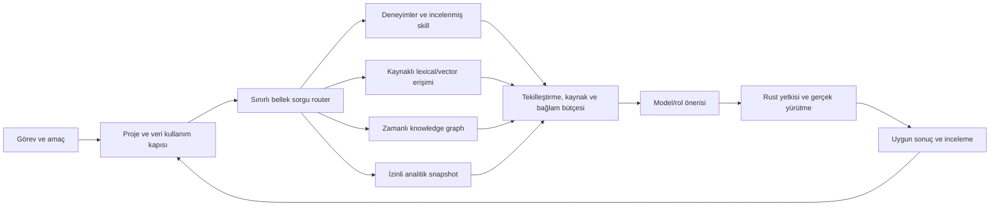

# Proje kapsamlı bellek katmanı

Sürüm **0.1.0**, 13 Ekim 2026. [English](../en/memory-layer.md). Bu belge kabul edilmiş tasarım yönü ve önerilen kabul çalışmalarını anlatır; uygulanmış bellek motoru değildir. G46 platform tanım sözleşmelerini sağlar; G63, G87–G90 ve yerel RAG/model kapıları kalan davranışı sağlar.

Bellek, planlama, karar, muhakeme, temsil, eleştirmen ve skill bileşenlerinin kullandığı platform yeteneğidir. Zorunlu onuncu model rolü veya ortak sohbet dökümü değildir. Bakımcı CortexDB ile **knowledge graph örüntüsünü** kastettiğini açıkladı; belirli proje ya da paket seçilmedi. Farklı depolama/sorgu profilleri sabit Rust sözleşmeleri altında farklı iş yüklerine hizmet edebilir.

| Bellek türü | Sakladığı | Kullanım ve yaşam döngüsü |
|---|---|---|
| `working` | Tek görev/döngü için sınırlı bağlam, bekleyen gözlem ve hipotezler | Kısa süre sonu; reset/iptalde bırakılır; ham prompt veya özel muhakeme otomatik kalıcılaştırılmaz |
| `episodic` | İzinli eylem/sonuç, insan düzeltmesi, doğrulanmış başarı/hata ve kaynak referansları | Replay ve öğrenme kürasyonu; toplama ve eğitim izinleri ayrı kalır |
| `semantic` | Kaynağa dayanan bilgi, belge parçaları ve sürümlü embedding’ler | Kesin kaynak/index/embedding sürümleri ve alıntı referanslarıyla RAG/hibrit erişim |
| `procedural` | İncelenmiş tekrar kullanılabilir skill referansları, kabul edilmiş reçeteler ve değerlendirmeleri | Skill adayı getirilir; yürütme güncel yetki ve uyumluluğu tekrar denetler |
| `knowledge_graph` | Türlü varlıklar, kaynak atıflı iddia/ilişkiler, zaman geçerliliği, kanıt ve çelişkiler | Sınırlı varlık/ilişki dolaşımı, lexical/vector erişimiyle birleşir; graph üyeliği doğruluk değildir |
| `analytical` | Sürümlü sonuç, kalite, gecikme, bellek ve maliyet toplulaştırmaları | İzinli snapshot’tan yönlendirme, kaynak tahmini ve iyileştirme önerisi; otomatik eğitim/harcama yok |

Her öğe proje/öğe/kaynak kimliklerini, bellek türünü, içerik/şema sürümünü, kaynak sürümü ve soy bağını, gözlem zamanını, geçerlilik/süre sonunu, doğrulama durumunu ve anlamlı olduğunda belirsizliği taşır. Vektör öğeleri ayrıca embedding uzayı/model/ön işleme/boyut/index sürümlerini bağlar. Graph iddiaları türlü uç noktaları ve ilişkileri adlandırır, kanıtlarını korur. Yalnız gözlenen gerçek veya açıkça incelenmiş iddia kabul edilmiş bilgi görünümüne girebilir; tahmin ve model kestirimleri etiketli kalır. Güven puanı ya da tekrarlanan model uzlaşması bir iddiayı yükseltmez. Çelişki iki kaynak atıflı iddiayı, zamanlarını ve çatışma durumunu korur; en yeni metin sessizce gerçek sayılmaz.

## Sınırlı okuma ve yazma akışı

Bellek yazımı amaç yetkisi ve uygun içerikle başlar. Rust şema, proje, kaynak, zaman alanları ve sınırları doğrular, ardından açık öğe/sürümü kalıcılaştırır. Deterministik yürütme makbuzu, incelenmiş insan düzeltmesi ve onaylanmış kaynak çıkarımı farklı yazım sınıflarıdır. Model bellek öğesi önerebilir; rıza veremez veya kanıtsız tahminini doğrulanmış gerçek olarak etiketleyemez. Ham özel muhakeme veya erişim bilgisi yükü bellek/dışa aktarma şema alanı değildir. Bu şema/veri kullanım sınırıdır; rastgele çağıran metninin otomatik sırdan arındırıldığı iddiası değildir.

Bellek okuması proje, görev/rol, amaç, bellek türleri, sorgu/profil sürümü, zaman ufku, öğe/sonuç/bayt/süre bütçelerini ve istenen kaynak türlerini bildirir. Politika filtreleri sıralama/dolaşım öncesi ve bağlam dönüşünden hemen önce çalışır. Lexical, vector ve graph sonuçları deterministik tekilleştirme ve kaynak bilgisiyle birleşir; çelişkili veya eksik kanıt açıktır. Bağlam birleştirici seçilen tokenizer varsa gerçekten serileştirilen bayt/token miktarını sayar; tokenizer yoksa token kapasitesi bilinmiyor kalır, bayt tavanı yine uygulanır. Geçerli sonuç yoksa açık boş sonuç gelir; backend hatası sessiz depo değişimine veya projeler arası erişime yol açamaz.

Rol/skill router her isteği tüm backend’lere göndermek yerine türlü **bellek alt akışı** seçer. Tarihsel karar öneri için kanıttır; eylemi tekrarlama yetkisi değildir. Getirilen belge, ilişki, skill ve araç açıklamaları güvenilmeyen içerik kalır. Rust yürütmede güncel eylem ve veri izinlerini tekrar denetler.

## Gizlilik, unutma ve kurtarma

G63’ün bağımsız `execute`, `collect`, `train`, `external_disclosure` ve `ecosystem_export` amaçları tüm bellek türlerini yönetir. Yerel okuma provider’a açıklama izni vermez; eğitim ekosistem paylaşımını yetkilendirmez. Özel kaynak, embedding, özet, graph ilişkisi, cache, analitik ve eğitilmiş aday bütün kaynak kısıtlarını miras alır. İzinli paylaşım paketi hak, soy bağı ve uygun içeriği taşır; içe alma ne etkinleştirme ne başka projenin verisine erişim verir.

Saklama süresi, geri çekme ve silme sonraki kaynak/türev okumalarını, cache bağlamını, graph kenarlarını ve erişim sonuçlarını geçersizleştirir. Devam eden aktarım politikayı tekrar denetler; önceden oluşturulan bağlam yeni geri çekmeyi aşamaz. Çökme/yeniden açılma, kalıcı kayıtlardan aynı kısıtlı görünümü yeni canlı kabiliyetlerle kurmalıdır. Her backend profili mantıksal silmeyi, korunan append-only/tombstone geçmişini, backup/snapshot politikasını ve fiziksel silme sınırlarını tanımlar. İzin geri çekme önceden açıklanmış dış kopyayı geri getiremez veya model unlearning’i kanıtlayamaz; etkilenen eğitim adayları kendi incelenmiş politikalarına kadar gelecekteki kullanımdan karantinaya alınır. Yerellik tek başına şifreleme, saldırgan aynı-kullanıcı dosya sistemi yalıtımı veya fiziksel silme vaadi değildir.

## Depolama/sorgu profilleri ve dış örnekler

| İş yükü profili | Eyleme uygulama yönü | Referans veya isteğe bağlı veri alışverişi adayı |
|---|---|---|
| Küçük sık durum/deneyim yazımları, anahtar erişimi ve yeniden başlatma | Kendi Rust canonical journal’ımız ve sınırlı transactional index; G13 kurtarması kabul edilmiş kapsamında kullanılır | SQLite’ın cihazda yerel gömülü depolama örüntüsü; yazıcı eşzamanlılığı açık profil sınırıdır |
| Varlık/iddia/ilişki ve kaynak dolaşımı | RAG vektörleriyle birlikte zaman geçerliliği, kaynak ve sınırlı dolaşım taşıyan kendi Rust graph index’imiz | Bakımcının kastettiği knowledge graph örüntüsü; belirli CortexDB bağımlılığı yok |
| Toplu değerlendirme/kaynak toplulaştırmaları ve snapshot taramaları | Kendi Rust sınırlı sütun odaklı özet ve analitik sorgularımız | DuckDB’nin analitik/sütun odaklı sorgu örüntüsü |
| Etkin görev bağlamı | Açık süre sonuyla sınırlı geçici Rust bağlam oluşturma | Kalıcı/global depo otomatik seçilmez |

SQLite C ile, DuckDB C++ ile uygulanır. Rust binding bu motorları birinci taraf Rust yapmaz. 13 Ekim 2026’da gözlenen resmî tasarım açıklamaları referanstır: [SQLite kullanım alanları](https://www.sqlite.org/whentouse.html), [SQLite uygulama özellikleri](https://www.sqlite.org/features.html), [DuckDB tasarımı](https://www.duckdb.org/why_duckdb). Profiller bunları kurmaz, üretim bağımlılığı onaylamaz, native dosya uyumluluğu veya benchmark üstünlüğü kanıtlamaz. Kullanıcının yönettiği dış araç/connector ya da referans denemesi gerçekten kabul edilmiş bağımlılık envanteri, kesin sürüm, kaynak ve ayrı yetki/veri kapılarını gerektirir. Mevcut kendi Rust politikası yürürlüktedir; desteklenmeyen backend seçimi unavailable döner. SQL lehçesi veya tam SQLite/DuckDB özellik eşitliği vaat edilmez.

## Goal kapıları ve yeniden değerlendirme

| Kapı | Sağlanacak davranış | Gerekli kanıt |
|---|---|---|
| G63 | Proje deposu ve bağımsız amaç uygulaması | Projeler arası red, türev mirası, geri çekme/süre sonu, native senkronizasyon/yeniden açılma; owner bootstrap gerçek insan kimliğinden ayrı |
| G87 | Ortak bellek sorgu/öğe/yaşam döngüsü sözleşmeleri ve router arayüzü | Geçersiz kaynak/profil/tür, sınırlı bağlam, yetki enjeksiyonu, eski embedding uzayı, süre sonu/geri çekme/cache geçersizliği reddi |
| G88 | Kendi Rust episodik/semantik/knowledge graph dilimi | Gerçek native kalıcılık ve ayrılmış EN/TR görevler; kaynak referansı, çelişki/zaman, bellek ile düz RAG karşılaştırması, kaynak sınırları |
| G89 | Kendi analitik snapshot ve toplulaştırmalarımız | Sonucu bilinen sorgular, sınırlı IO/bellek/süre, miras izinleri ve geri çekilmiş kaynağın dışlanması |
| G90 | Backend kabiliyet kaydı ve kontrollü veri alışverişi | İki kendi iş yükü profili, eksik/desteksiz profil reddi ve kimlik/soy bağının korunması; üçüncü taraf referans yürütmesi ayrıca envanterlenir |

Mevcut G12/G13 kalıcılık/kurtarması yararlıdır; agent belleği, relational/graph index veya unutmayı kanıtlamaz. G46 ProjectId erişim kontrolü değil ilişkidir. G67–G71 kaynak/embedding/index kabulünü sağlar ve bellek görünümünü bağlamalıdır; G75 incelenmiş skill anlamını sağlar; G33/G34 toplama/dataset soy bağı sağlar, otomatik rıza vermez. Erken metin kanıtı G72 artık G88 belleğini izinli sentetik/test kaynaklarıyla sınar; ses/görsel/dünya modellerini beklemez. G71 tam RAG, G74 router, G79 iyileştirme ve G82 kaynak hesabı ilgili kabul edilmiş bellek kapılarını kullanır. İsteğe bağlı analitik/backend kapsamı erken metin kanıtına dahil değildir.

Sonlu prototip sınırları, kesin dosyalar ve kalite/kaynak eşikleri her kartın etkinleştirme planında sabitlenir. İlk önerilen iş yükleri küçük sınırlı yerel test kaynakları ve tek kendi graph/vector index’imizdir; bu belge gerçek özel corpus, provider çağrısı, eğitim adayı veya yeni harcama yetkilendirmez. Kart başına native/CI kontrolleri ve gerçek ayrı son-head inceleme merge’den önce gelir; desteksiz model/veritabanı ve bilinmeyen ölçüm açık kalır.
